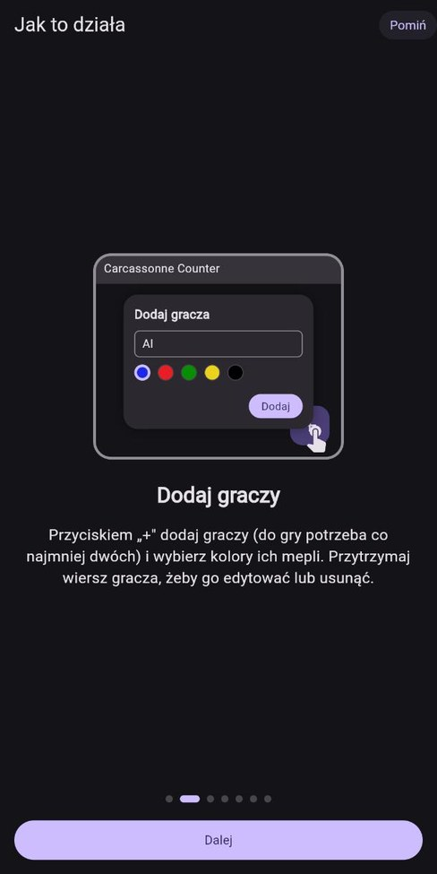
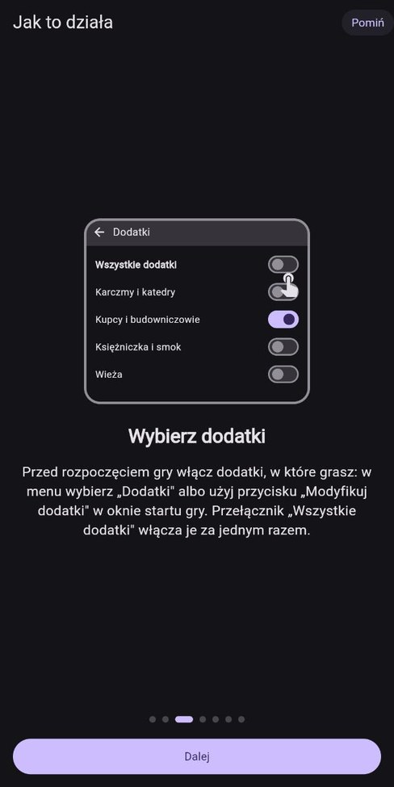
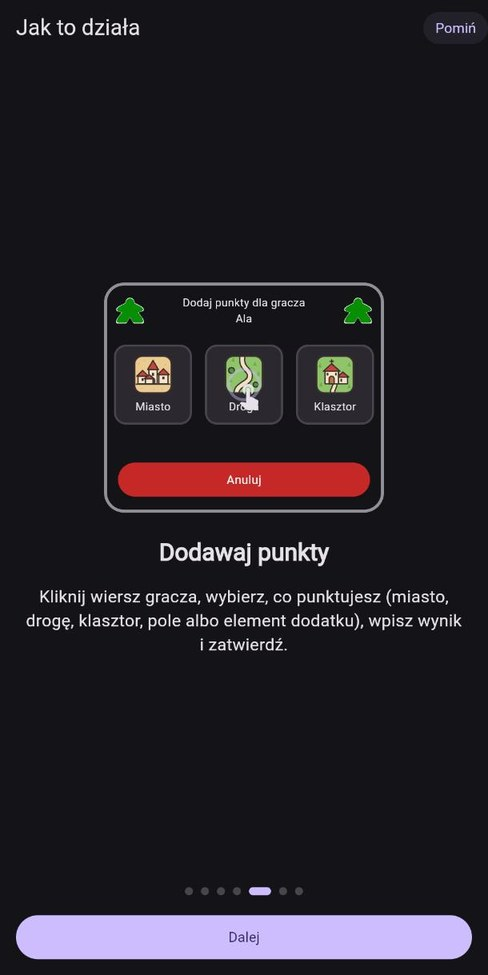
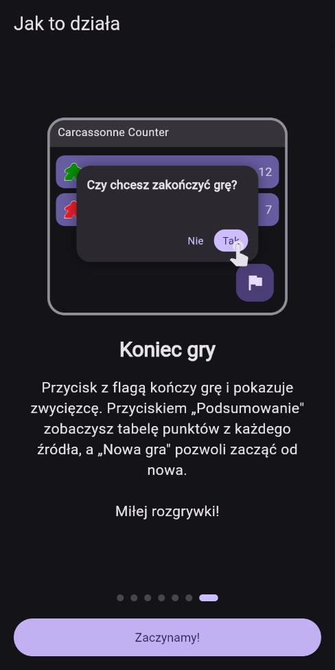

# Carcassonne Counter

Aplikacja we Flutterze do liczenia punktów w grze planszowej Carcassonne,
z obsługą wielu dodatków. Interfejs po polsku i angielsku, działa na telefonach
i tabletach (w pionie i w poziomie).

  
  
  
  

## Najważniejsze funkcje

- lista graczy z meplami w wybranych kolorach i bieżącym wynikiem,
- punktacja miasta, drogi, klasztoru i pól, także z punktami wspólnymi
  dla kilku graczy,
- punktacja elementów włączonych dodatków,
- cofanie ostatniego zatwierdzenia punktów,
- ekran końca gry z rankingiem i podsumowaniem punktów z każdego źródła,
- skrót zasad i krótki samouczek wbudowany w aplikację,
- motyw jasny, ciemny lub systemowy oraz wybór języka,
- zapis stanu gry w pamięci urządzenia.

## Obsługiwane dodatki

- Karczmy i katedry
- Kupcy i budowniczowie
- Księżniczka i smok
- Mosty, zamki i bazary
- Wieża
- Opactwo i burmistrz
- Kopalnie złota
- Cyrk objazdowy
- Owce i wzgórza
- Klasztory niemieckie i holenderskie
- Zamki w Niemczech
- Katedry w Niemczech

## Pobierz

[Przetestuj w przeglądarce](https://wgfizban.github.io/CC_NEW/)

[Pobierz najnowszy plik APK](https://github.com/WGFizban/CC_NEW/releases/latest/download/CarcassonneCounter.apk)
([wszystkie wydania](https://github.com/WGFizban/CC_NEW/releases)).
